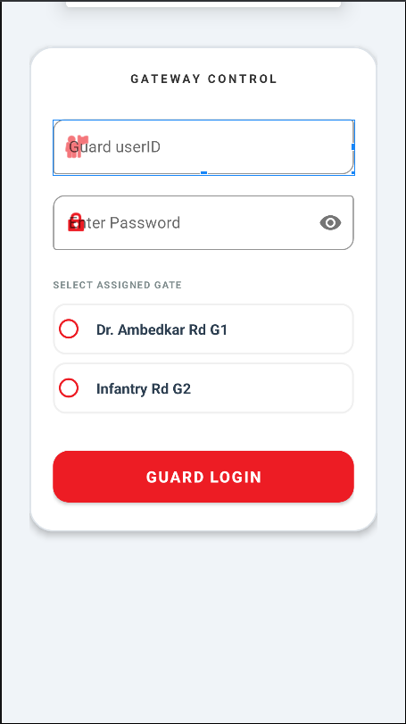
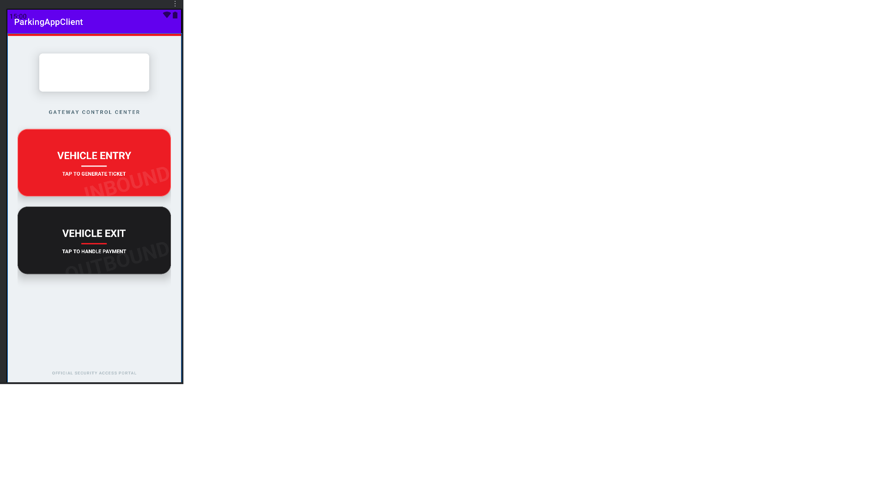
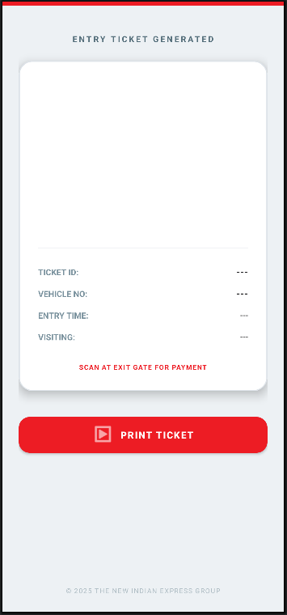
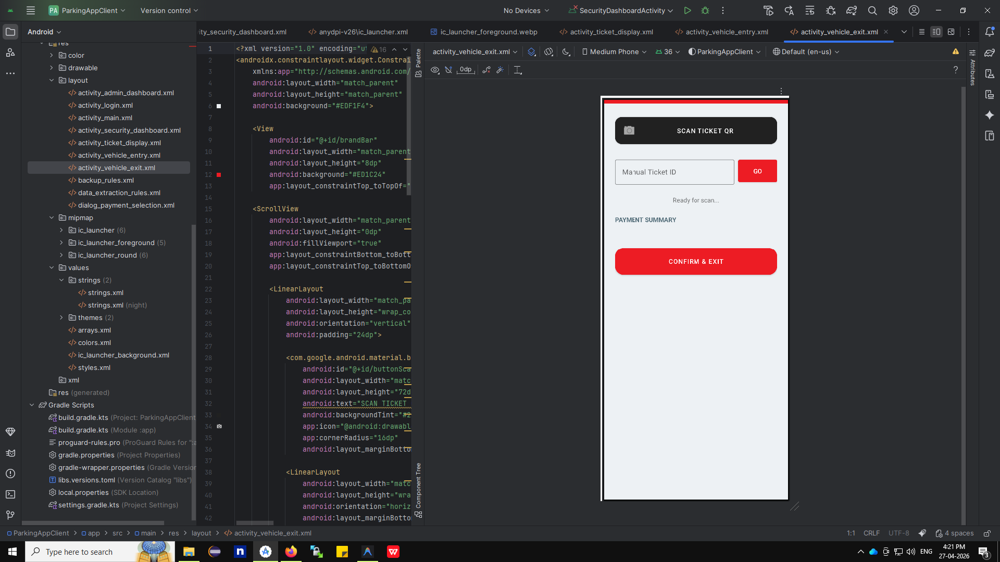

# 🚗 Smart Parking System - Android Application

A modern Android-based Smart Parking System that enables users to efficiently manage parking through secure authentication, vehicle registration, parking slot booking, payment management, and booking history.

## 📱 Features

- 🔐 User Authentication
- 🚘 Vehicle Registration & Management
- 🅿️ Parking Slot Booking
- 📍 Real-Time Parking Availability
- 🎫 Digital Parking Ticket Generation
- 💳 Secure Payment Interface
- 🚪 Exit Management
- 🛡️ Security Dashboard
- 📖 Booking History
- 📱 User-Friendly Android Interface

---

## 🛠️ Tech Stack

## 🛠️ Tech Stack

- Java
- Android Studio
- XML
- Gradle (Kotlin DSL)
- Retrofit
- Gson
- OkHttp Logging Interceptor
- ZXing (QR Code Scanner)
- REST APIs
- AndroidX
- Material Design Components

---

## 📂 Project Structure

```
SmartParkingSystem/
│── app/
│── gradle/
│── README.md
│── build.gradle.kts
│── settings.gradle.kts
```

---

## 📸 Application Screenshots

### Login


### Vehicle Registration


### Payment


### Security Dashboard


### Parking Ticket


### Exit Screen


---

## 🚀 Getting Started

### Prerequisites

- Android Studio
- JDK 17 or later
- Android SDK

### Installation

1. Clone the repository

```bash
git clone https://github.com/yourusername/SmartParkingSystem.git
```

2. Open the project in Android Studio.

3. Sync Gradle.

4. Build and Run the application on an Emulator or Android Device.

---

## 📌 Future Improvements

- Firebase Authentication
- Cloud Firestore Integration
- Push Notifications
- QR Code Based Entry & Exit
- EV Charging Slot Support
- Admin Analytics Dashboard
- Google Maps Integration

---

## 🤝 Contributing

Contributions are welcome!

Feel free to fork this repository, improve the project, and submit a Pull Request.

---

## 📄 License

This project is licensed under the MIT License.

---

## 👨‍💻 Author:Sakina muzzammil

Developed as an Android Smart Parking System project for learning and portfolio purposes
